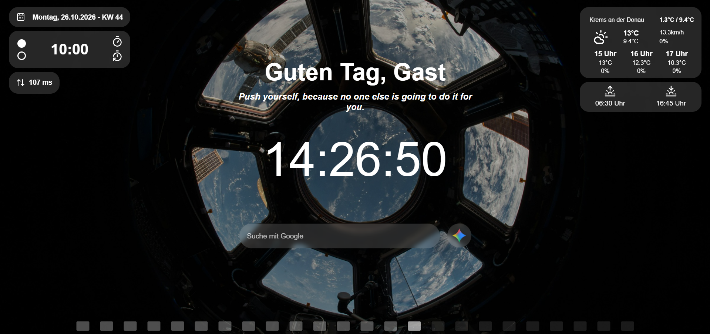

# HTML-CSS-JS-Browser-Landigpage
A clean, personal browser landingpage featuring live weather, date and timer widgets, quick search and a clock with a visual day progress bar.

## Features

- **Time-Based Greeting:** Dynamically greets the user depending on the time of day (Morning, Afternoon, Evening, Night).
- **Random Motivational Quotes:** Displays a randomly selected inspirational quote on every page load.
- **Digital Clock:** Real-time clock display showing hours, minutes, and seconds.
- **Glassmorphism Search Bar:** Integrated Google search with custom URL detection and a direct quick-launch button for Google Gemini.
- **Visual Day Progress Bar:** A 24-hour visual progress tracker highlighting elapsed, current, and remaining hours of the day.
- **Weather Widget:** Displays current weather metrics (temperature, feel-like temp, wind speed, rain probability, min/max temp) and a 3-hour forecast using the Open-Meteo API.
  - **Location Toggle:** Click on the location button to switch instantly between Vienna and Krems an der Donau.
- **Sun Times Widget:** Shows exact daily sunrise and sunset times based on the selected location.
- **Date & Calendar Week Widget:** Displays the current weekday, formatted date, and calculated ISO calendar week (KW).
- **Timer & Stopwatch Widget:** Dual-mode productivity widget featuring:
  - Custom timer duration input via keyboard with visual blinking indicators on completion.
  - Stopwatch with millisecond precision, start/stop, and reset controls.
- **Network Latency Ping Widget:** Measures and displays real-time connection latency in milliseconds.
- **Scroll Snap Navigation:** Smooth scroll-snap transition directing down beneath the hero section *(Work in Progress)*.

## Usage

1. Open `index.html` in your browser or set it as your browser's custom new tab / startpage.
2. Use the search bar to search directly on Google or enter a full URL to navigate immediately.
3. Click the Gemini button next to the search bar to launch Google Gemini.
4. Click on the location name in the weather widget to toggle weather data between Vienna and Krems.
5. Switch between **Timer** and **Stopwatch** modes using the top widget selection buttons:
   - In Timer mode, click reset to enter a new duration via number keys and press Enter to start.
   - In Stopwatch mode, use the controls to measure elapsed time.

## Technical Notes

- Dynamic UI updates powered by jQuery and standard Web APIs.
- Real-time weather and astronomical data fetched asynchronously via the free Open-Meteo REST API.
- Network latency is calculated using asynchronous HEAD fetch calls.
- Iconography provided dynamically through Lucide Icons.
- Fully responsive layout utilizing CSS flexbox and grid components.
- Zero backend dependencies; executes entirely client-side within the browser.

  ### Technologies Used
  - HTML5
  - CSS3
  - JavaScript (ES6+ & jQuery 3.7.1)
  - Lucide Icons
  - Open-Meteo API

## Preview

## GitHub Page

Link: https://manuel-amberger.github.io/HTML-CSS-JS-Browser-Landigpage/

## Credits & Attributions

- **Background Photo:** Photo by [NASA](https://unsplash.com/de/@nasa?utm_source=unsplash&utm_medium=referral&utm_content=creditCopyText) on [Unsplash](https://unsplash.com/de/fotos/space-shuttle-blick-ausserhalb-der-erde-CpHNKNRwXps?utm_source=unsplash&utm_medium=referral&utm_content=creditCopyText).
- **Icons:** Powered by [Lucide Icons](https://lucide.dev/).

## About

Created by Manuel Amberger, a student at a technical high school (HTL) in Austria.
